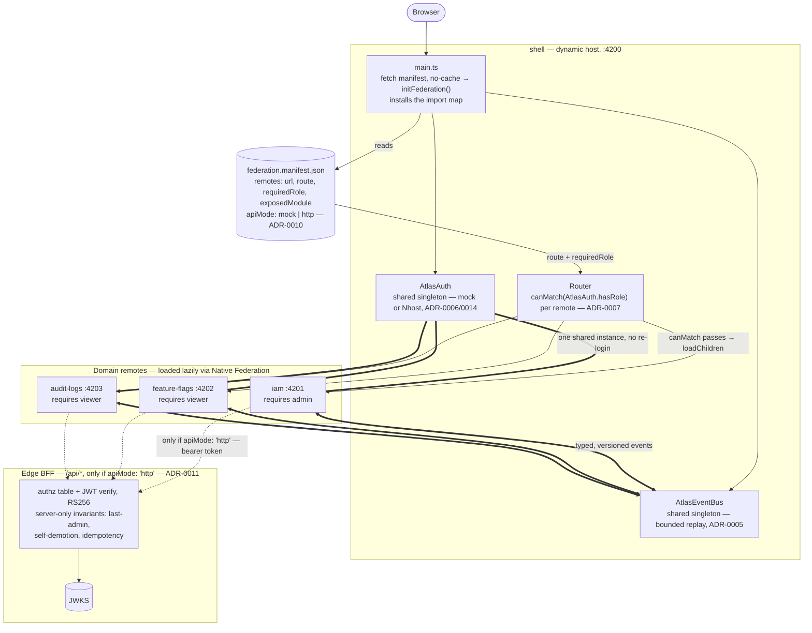

# Atlas Admin Shell

[](https://github.com/EleoXDA/Atlas-Admin-Shell/actions/workflows/ci.yml)


An enterprise-grade **microfrontend control plane**: a zoneless Angular shell that composes three
independently deployable domain remotes — **IAM**, **Feature Flags**, and **Audit Logs** — at runtime
via [Native Federation](https://native-federation.com) and a manifest-driven remote registry.

## What is Atlas Admin Shell

A production-shaped admin platform demonstrating how a large organization runs many domain teams
against one shell: each remote is built, tested, and deployed on its own, and the shell discovers it
at runtime from `federation.manifest.json` — adding a domain to the platform is a manifest edit, not
a shell rebuild.

## Why this exists

This is a portfolio flagship whose deliverable is **architecture, not features**: runtime federation
on web standards (ES modules + import maps), zoneless signals-first Angular, strict domain
boundaries enforced by the build system, typed cross-microfrontend contracts, and every significant
decision recorded as an ADR with dated, verifiable receipts.

## Architecture



Thin solid arrows are deterministic call and configuration flow: reading the manifest, building
routes from it, `canMatch` letting a navigation through. Thick arrows are the two shared
singletons — `AtlasAuth` and `AtlasEventBus` — that cross the federation boundary as one instance per
browser session, not a call. Dotted arrows are conditional at runtime: a remote reaches the edge BFF
only when the manifest sets `apiMode: 'http'`; every manifest committed in this repo defaults to
`'mock'` (ADR-0010), so a fresh checkout runs every domain with zero server calls. The manifest is
the only thing that tells the shell which remotes exist at all: adding a domain is an edit there,
never a shell rebuild.

| App | Role | Port (dev) | Route |
| --- | --- | --- | --- |
| `shell` | Dynamic host: chrome, auth, remote orchestration, error boundaries | 4200 | `/` |
| `iam` | Users, roles, access management | 4201 | `/iam` |
| `feature-flags` | Flag dashboard with toggles | 4202 | `/flags` |
| `audit-logs` | Searchable event log | 4203 | `/audit` |

## Key decisions

Every decision is an ADR in [`docs/adr/`](docs/adr/), each with a **Verification** section holding
dated receipts (npm peer ranges, GitHub issue states) for its claims.

| ADR | Decision |
| --- | --- |
| [0001](docs/adr/0001-nx-with-native-federation.md) | Nx monorepo + Native Federation, despite no official Nx support for it |
| [0002](docs/adr/0002-angular-21-lts-over-angular-22.md) | Angular 21 LTS over GA Angular 22 |
| [0003](docs/adr/0003-zoneless-change-detection.md) | Zoneless change detection everywhere; zone.js never enters the dependency tree |
| [0004](docs/adr/0004-manifest-driven-dynamic-host.md) | Remotes resolved at runtime from a manifest, not build-time imports |
| [0005](docs/adr/0005-per-domain-signal-stores-and-typed-event-contracts.md) | Per-domain Signal Stores + typed, versioned cross-MFE event contracts |
| [0006](docs/adr/0006-mock-first-auth-behind-interface.md) | Mock-first auth behind a DI interface; a real provider as a drop-in later (now Nhost, ADR-0014) |
| [0007](docs/adr/0007-remote-error-boundaries.md) | Remote error boundaries: reject rather than cache a fallback; recover by re-initialising the remote |
| [0008](docs/adr/0008-storybook-webpack-framework-with-a11y-gate.md) | Storybook on the webpack Angular framework, with accessibility as a CI gate |
| [0009](docs/adr/0009-federation-e2e-on-production-builds-in-ci.md) | Federation e2e against production builds served statically in CI |
| [0010](docs/adr/0010-manifest-is-a-deployment-artifact.md) | The federation manifest is a deployment artifact, not a build input |
| [0011](docs/adr/0011-edge-bff-as-the-authorization-boundary.md) | The edge BFF is the authorization boundary; the client only hides things |
| [0012](docs/adr/0012-lighthouse-without-lhci-and-an-honest-budget.md) | Drive Lighthouse directly rather than the dormant LHCI wrapper; budget for the architecture we chose |
| [0013](docs/adr/0013-ci-runs-locally-while-the-repository-is-private.md) | Run the gates locally while the repository is private |
| [0014](docs/adr/0014-nhost-replaces-supabase-as-identity-provider.md) | Nhost replaces Supabase as the identity provider |

## Quickstart

```bash
# Node 24.18 (fnm picks up .nvmrc automatically) and pnpm via corepack
corepack enable   # if corepack is missing: npm i -g corepack

git clone git@github.com:EleoXDA/Atlas-Admin-Shell.git
cd Atlas-Admin-Shell
pnpm install

# Start everything (shell + all remotes)
pnpm exec nx run-many -t serve -p shell,iam,feature-flags,audit-logs --parallel=4
# ...or just the shell
pnpm exec nx serve shell
```

## Repository structure

```
apps/
  shell/           # dynamic host
  shell-bff/       # edge BFF: the /api/* Worker on the shell's origin
  iam/             # remote: identity & access
  feature-flags/   # remote: flag dashboard
  audit-logs/      # remote: event log
libs/
  shared/
    ui/            # design-system components (buildable)
    design-tokens/ # Style Dictionary → CSS vars + Tailwind @theme
    contracts/     # cross-MFE types: manifest, versioned events (buildable)
    auth/          # AtlasAuth interface + providers (buildable)
    event-bus/     # AtlasEventBus singleton with replay (buildable)
    util/          # shared store features (withRequestStatus)
docs/
  adr/             # architecture decision records (MADR)
```

## Quality gates

> **Run them with `pnpm run ci:local`.** GitHub Actions is metered on private repositories and this
> one has exhausted its monthly allowance, so the `CI` and `Deploy` workflows are disabled and the
> pipeline runs locally instead (ADR-0013). The local runner is *stricter* than the workflow was —
> it uses `run-many` rather than `affected`, so no gate can be skipped for want of a project-graph
> edge. `ci:local:quick` skips the four browser-driven gates; do not merge on that alone.

| Gate | What it runs | Where |
| --- | --- | --- |
| Unit + contract tests | Every project, incl. a frozen event-catalogue snapshot | `nx affected -t test` |
| Accessibility (components) | axe on every Storybook story, `a11y.test: 'error'`. Each story renders in **one** theme — light unless it opts into dark (only the badge, button and nav-item dark variants do), so dark mode is not covered story by story | `nx affected -t test-storybook` |
| Accessibility (application) | axe over the real federated console, every remote, both themes | `nx affected -t e2e` |
| Control affordances | WCAG 1.4.11 boundary contrast, which axe does **not** automate | `nx affected -t e2e` |
| Federation e2e | Playwright specs against production builds over real import maps | `nx affected -t e2e` |
| Auth boundary | no remote may bundle the identity client (ADR-0006) | `pnpm run bundles:check` |
| Edge authorization | token verification and role rules in real workerd (ADR-0011) | `nx test shell-bff` |
| Edge API over HTTP | the real Worker via `wrangler dev`, no credentials needed | `nx e2e shell-bff-e2e` |
| Performance | Lighthouse over the shell AND a federated route, median of 3 | `nx run shell:lighthouse` |
| Design tokens | the committed CSS still matches `tokens/*.json` | `pnpm run tokens:check` |
| Deploy artifacts | every environment manifest satisfies the contract | `pnpm run manifest:check` |
| Boundaries | `@nx/enforce-module-boundaries` tag rules | `nx affected -t lint` |
| Zoneless | fails if `zone.js` ever resolves into the tree (ADR-0003) | `pnpm run ci:local` |
| All of the above | fourteen gates, one command, continues past the first failure | `pnpm run ci:local` |

## Deploying

The platform deploys as **four independent Workers**, one per app, each on its own origin — which is
the point rather than an accident: the remotes really are cross-origin, so the import map, the CORS
headers and the error boundary are all exercised in production exactly as ADR-0004 describes.

| App | URL |
| --- | --- |
| `shell` | https://atlas-shell.eleo-666.workers.dev |
| `iam` | https://atlas-iam.eleo-666.workers.dev |
| `feature-flags` | https://atlas-feature-flags.eleo-666.workers.dev |
| `audit-logs` | https://atlas-audit-logs.eleo-666.workers.dev |

Each app publishes as a Cloudflare Worker serving static assets (`apps/<app>/wrangler.jsonc`). The
shell sets `not_found_handling: "single-page-application"` because it owns routes; the remotes
deliberately do not, so a missing chunk 404s and the shell's error boundary can classify it rather
than receiving HTML with a 200.

Deploys run from a developer machine: the `Deploy` workflow is disabled while the repository is
private (ADR-0013), so nothing publishes on merge. The environment lives in the **manifest**, never
in the build (ADR-0010). With `CLOUDFLARE_API_TOKEN` set in the shell:

```bash
pnpm run manifest:check                       # validate every environment manifest
for app in iam feature-flags audit-logs shell; do
  ATLAS_ENV=production pnpm exec nx run $app:deploy
done
```

Deploy all four from the same commit, remotes first and the shell last. Shell and remotes share
singletons at runtime, so a new shell in front of old remotes risks a version mismatch; the shell
goes last because it carries the manifest that points browsers at the remotes. A merge does not
deploy anything: on 2026-10-25 production turned out to be missing #38–#44 and was still serving
the mock personas. After deploying, check the live manifest rather than the deploy log:
`curl -s https://atlas-shell.eleo-666.workers.dev/federation.manifest.json`.

The deploy target builds, swaps in that environment's registry, and uploads — in
that order, as one step. Applying the manifest separately would not work: the target
depends on `build`, so a rebuild between the two silently restores the committed
localhost registry, and the deploy would still look green while shipping a console
whose remotes all point at localhost. `apply-manifest` reads the file back after
copying so that failure cannot pass unnoticed.

`nx affected -t deploy -c check` type-checks every wrangler config against its asset directory and
needs no account; `ci:local` runs it on every change. The `Deploy` workflow (`.github/workflows/
deploy.yml`) is kept for when Actions is back: it publishes only when `CLOUDFLARE_API_TOKEN` and
`CLOUDFLARE_ACCOUNT_ID` are set as repository secrets, and reports that it skipped otherwise.

Repointing a remote is editing one file in `deploy/manifests/<env>/` and re-uploading it. No
rebuild, no shell redeploy.

## Engineering practices

- **Conventional commits**; trunk-based development — direct commits for the foundation slice,
  short-lived PRs (squash-merged) from slice 2 onward.
- **Affected-based CI**: `nx affected` via `nrwl/nx-set-shas`, so only changed projects build.
- **Module boundaries as law**: `@nx/enforce-module-boundaries` with `scope:`/`type:` tags —
  domains cannot import each other's internals; only `scope:shared` crosses boundaries.
- **Single-version policy**: all `@angular/*` pinned via pnpm overrides so every federation
  participant shares byte-identical framework versions.
- CODEOWNERS/branch protection intentionally omitted (solo repository) — noted as a decision.

## Roadmap

- [x] **Slice 1 — Foundation → Federation**: Nx workspace, boundaries, token pipeline, zoneless
  shell, Native Federation with 3 remotes loading from the manifest, mock auth, CI.
- [x] **Slice 2 — Domains + State**: NgRx Signal Stores per remote, typed event bus + contract
  tests, error boundaries with retry/fallback, Storybook + a11y, federation E2E suite in CI.
- [ ] **Slice 3 — BFF + Deploys**: Cloudflare Workers (static assets) per app, `nx affected`
  deploy pipelines, PR previews, edge BFF, real identity provider swap-in.
  - [x] Per-environment manifests as deploy artifacts, wrangler config per app, deploy targets and
    a credential-gated deploy workflow. All four Workers are live; publishing runs locally while
    the workflow is disabled (ADR-0013, see Deploying).
  - [x] A real identity provider behind the existing `AtlasAuth` interface. The first adapter was
    Supabase; ADR-0006 carries an honest amendment on where the "drop-in" claim did and did not
    hold. It was replaced by Nhost (ADR-0014): a hand-written REST client with no SDK, the edge
    pinned to RS256 against the project's live JWKS, and the role read from
    `x-hasura-allowed-roles`. The production manifest names the Nhost project; dev and e2e still
    run on the mock. **Production sign-in shown 2026-10-25**, after the redirect URL was
    allow-listed and all four Workers were redeployed: a GitHub sign-in on the live console, done
    by hand. No automated test drives it, and token refresh in production is not yet shown.
  - [x] Edge BFF on the shell's Worker (`/api/*`), verifying tokens and enforcing authorization
    server-side — including invariants the client cannot, such as refusing to demote the last admin.
    Closed a real hole: a viewer could toggle a feature flag (ADR-0011).
  - [x] Remotes call the BFF over HTTP behind a contract, selected by the manifest's `apiMode`;
    the mock stays the default so the console runs with no backend.
  - [ ] PR previews. Not built; they need a workflow to run in, and Actions is disabled (ADR-0013).
- [ ] **Slice 4 — Polish**: Lighthouse CI + Core Web Vitals, axe pass, whitepaper completion,
  demo video, Angular 22 migration (deferred on cost/benefit, see ADR-0002) as a showcase PR.
  - [x] Lighthouse in CI over the production build, measuring both the shell alone and a **federated**
    route, so the cost of runtime composition is visible rather than assumed (ADR-0012). INP is
    deliberately not asserted — a lab run cannot produce it.
  - [x] axe pass — gated on every Storybook story in both themes and across the whole console.
  - [x] Whitepaper completion — this README carries the architecture diagram, every ADR with dated
    receipts, and the full quality-gate table; nothing here is a stub.
  - [ ] Demo video (needs a person on camera).
  - [ ] Angular 22 migration — **deliberately deferred**, not blocked (ADR-0002). Nx, NgRx,
    Storybook and Native Federation all support Angular 22 as of 2026-10-22; the original blocker
    expired. Staying on 21 is now a cost/benefit call: 22 has no `v22-lts` tag yet, nothing in it
    addresses a gap this codebase has, and its `canMatch` signature change lands on the exact
    mechanism ADR-0007 is built around.

Nx Cloud (remote caching) is deliberately not connected yet; opting in later is
`pnpm exec nx connect` on the free Hobby plan.

## License

[MIT](LICENSE)
